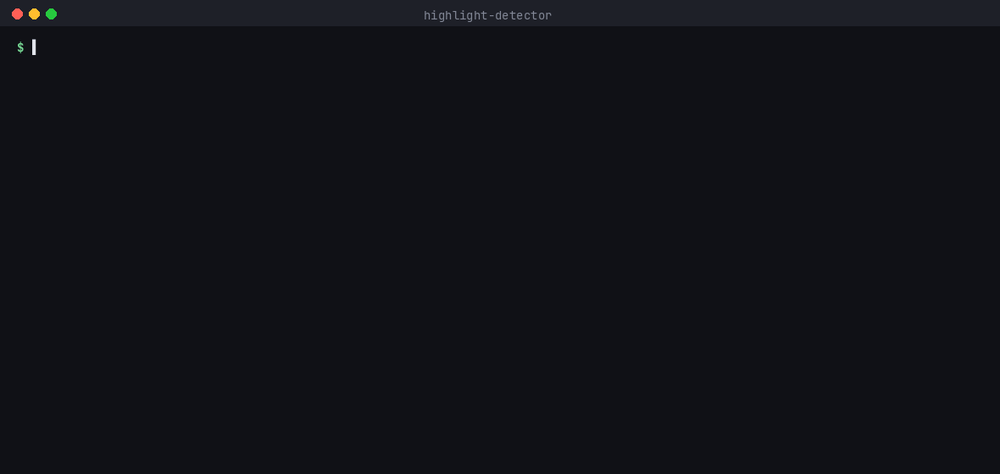

# highlight-detector

**Find the action in long gameplay recordings and stream VODs.** One command, runs on your machine, no GPU, no API keys, no upload.

```bash
pipx install git+https://github.com/uralozden/highlight-detector
highlight-detector my_3h_stream.mp4 --export clips/
```



It listens and watches for the moments where *something happens*: gunfights, explosions, crashes, a streamer losing it, chat exploding. You get a ranked list with timestamps and a plain-language reason for each pick, and optionally the clips cut as MP4s.

Built for GTA / RP streams, shooters, racing and any long gameplay session where scrubbing through hours of footage is the bottleneck.

## Why

Clipping a 3-hour VOD by hand takes longer than the stream. Most "AI clipping" tools are built for podcasts: they transcribe speech and look for quotable sentences. Gameplay highlights are usually **not** in the transcript; they are in the audio spikes, the motion, and the chat. This tool looks there.

## Features

- **7 signals**, each one cheap and language-independent
  - `loudness` – spikes relative to the last two minutes, so a streamer who gets louder over the night doesn't flatten later peaks
  - `transients` – sharp sound hits (shots, impacts, explosions) via spectral flux
  - `motion` – how fast the picture is changing
  - `cuts` – hard scene changes
  - `flash` – sudden brightness jumps (muzzle flashes, explosions)
  - `chat` – message rate from a chat replay (`--chat`), usually the strongest signal a streamer has
  - `speech_hype` – hype words in subtitles (`--subs`), English and Turkish out of the box ("no way", "let's go", "yok artık", "oha")
- **Clip boundaries that make sense**: follows the action while it lasts, keeps a few seconds of setup before it and a short reaction after, respects `--min-len` / `--max-len`, keeps picks apart (`--min-gap`)
- **Explains every pick**: `chat burst (150 msg/min vs 24 typical); loud spike (+35 dB over the previous minute)`
- **Outputs**: terminal table, JSON, CSV, YouTube chapters, CMX3600 EDL (opens as a timeline in DaVinci Resolve / Premiere), timeline PNG
- **Cuts the clips** with `--export DIR` (frame-accurate re-encode, or `--copy` for instant keyframe cuts)
- **MCP server**: ask Claude, Cursor or any MCP client "find the best moments in ~/Videos/stream.mkv and cut the top 5"
- Streams decoding through FFmpeg, so a 10-hour VOD never has to fit in memory
- Only dependency: NumPy (+ FFmpeg on your PATH)

## Install

Requires Python 3.10+ and [FFmpeg](https://ffmpeg.org/download.html) (`brew install ffmpeg`, `sudo apt install ffmpeg`, `winget install ffmpeg`).

```bash
pipx install git+https://github.com/uralozden/highlight-detector
# extras: timeline PNG and MCP server
pipx install "highlight-detector[plot,mcp] @ git+https://github.com/uralozden/highlight-detector"
```

## Usage

```bash
# ranked table in the terminal
highlight-detector session.mp4

# use the chat replay too (TwitchDownloader JSON, CSV, or "[1:02:03] user: msg" text)
highlight-detector stream.mkv --chat chat.json -n 15

# cut the top 10 into MP4s
highlight-detector stream.mkv --export clips/

# YouTube chapters for the VOD description
highlight-detector vod.mp4 --format chapters > chapters.txt

# an edit-ready timeline for Resolve / Premiere
highlight-detector vod.mp4 --format edl -o picks.edl

# JSON for scripts (default when piped)
highlight-detector vod.mp4 | jq '.highlights[] | {start_sec, end_sec, score}'

# tune it for your game: racing is all motion, a horror game is all audio
highlight-detector race.mp4 --weights motion=0.5,loudness=0.2
highlight-detector horror.mp4 --audio-only        # ~30x faster, skips video decoding
```

All options: `highlight-detector --help`.

### JSON output

```json
{
  "source": "sample.mp4",
  "duration_sec": 600.0,
  "features": ["chat", "cuts", "flash", "loudness", "motion", "transients"],
  "highlights": [
    {
      "rank": 1,
      "start_sec": 124.5,
      "end_sec": 148.0,
      "peak_sec": 134.0,
      "score": 100,
      "signals": {"loudness": 1.0, "transients": 1.0, "motion": 1.0, "cuts": 0.0, "flash": 0.065, "chat": 1.0},
      "reason": "chat burst (150 msg/min vs 24 typical); loud spike (+35 dB over the previous minute); sharp sound hits (shots, impacts, explosions)"
    }
  ]
}
```

### MCP server (Claude Desktop, Claude Code, Cursor)

```json
{
  "mcpServers": {
    "highlight-detector": { "command": "highlight-detector-mcp" }
  }
}
```

Tools: `find_highlights(video_path, top, min_len, max_len, chat_path, subtitles_path)` and `export_highlights(video_path, out_dir, top, copy)`.

### Python

```python
from highlight_detector import detect, Options

result = detect("stream.mp4", Options(top=5, max_len=30), chat="chat.json")
for h in result["highlights"]:
    print(h["start_sec"], h["end_sec"], h["score"], h["reason"])
```

## How it works

1. FFmpeg streams 16 kHz mono audio and tiny 64×36 grayscale frames (4 fps) into NumPy.
2. Every 0.5 s gets a value per signal. Each signal is normalised against **this video's own baseline** (median and MAD), so a quiet strategy game and a loud shooter are each judged on their own terms.
3. Signals are blended with public, tunable weights into one intensity curve (a weighted quadratic mean, so one very strong signal like a chat explosion can carry a moment on its own), then smoothed over 2 s.
4. Greedy peak picking: take the highest point, follow the action left and right while it stays well above the baseline, add setup and reaction, mask it out, repeat.

The `score` (0–100) means "how much is happening here compared with the rest of this video". **It is not a prediction of views or virality**, and a score of 100 in a boring video is still the least boring part of a boring video.

Default weights: `loudness 0.30, transients 0.20, motion 0.20, cuts 0.05, flash 0.05, speech_hype 0.15, chat 0.35` (only signals that exist are used, and weights are re-normalised).

## Speed

Measured on a 4 vCPU Linux VM: a 14-minute 1080p recording takes **41 s** with video analysis and **1.4 s** with `--audio-only`. Video decoding is the bottleneck, so a fast CPU (or `--audio-only` for audio-driven games) matters most.

## Limitations (honest list)

- It finds *intensity*, not *meaning*. A funny quiet moment, a clever play with no sound, or a great line of dialogue can be missed. Add `--subs` (e.g. from Whisper) or `--chat` to catch more of those.
- Loud intro/outro music and menu screens can rank high. Trim them, or check the top picks.
- Constant game music lowers the audio signals' contrast; motion and chat still work.
- The demo above uses a synthetic, reproducible sample (`python examples/make_sample.py`) because we can't ship game footage. Try it on your own recordings and tell us how it does.

## Want vertical clips, not just timestamps?

highlight-detector finds the moments. **[HookHarvest](https://hookharvest.co)** is the hosted app built by the same team that turns them into ready-to-post 9:16 Shorts / TikToks / Reels: auto-reframe with face tracking, burned-in captions, titles and branding overlays, in the browser.

## Contributing

Issues and PRs welcome, especially:

- tuning reports: "on game X the defaults picked Y, these weights worked better"
- new signals (kill-feed OCR, crowd/laughter detection, Kick / YouTube chat formats)
- PyPI packaging and a Windows test run

```bash
git clone https://github.com/uralozden/highlight-detector && cd highlight-detector
pip install -e '.[dev]'
pytest -q && ruff check src tests
```

## License

MIT. Only analyse footage you have the right to use.
